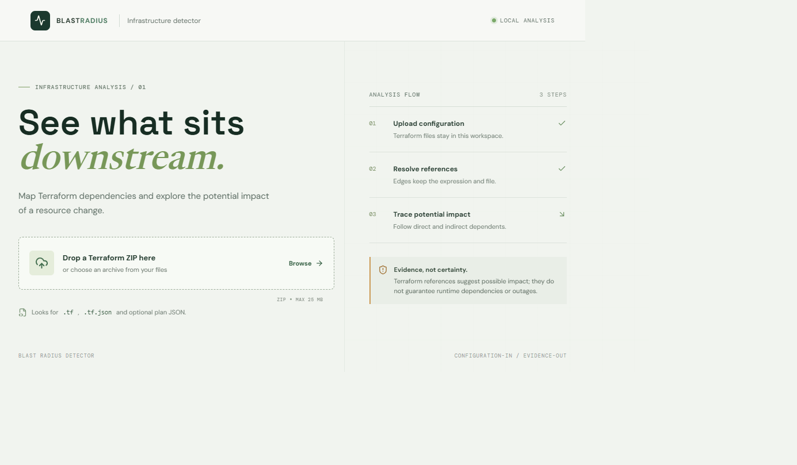
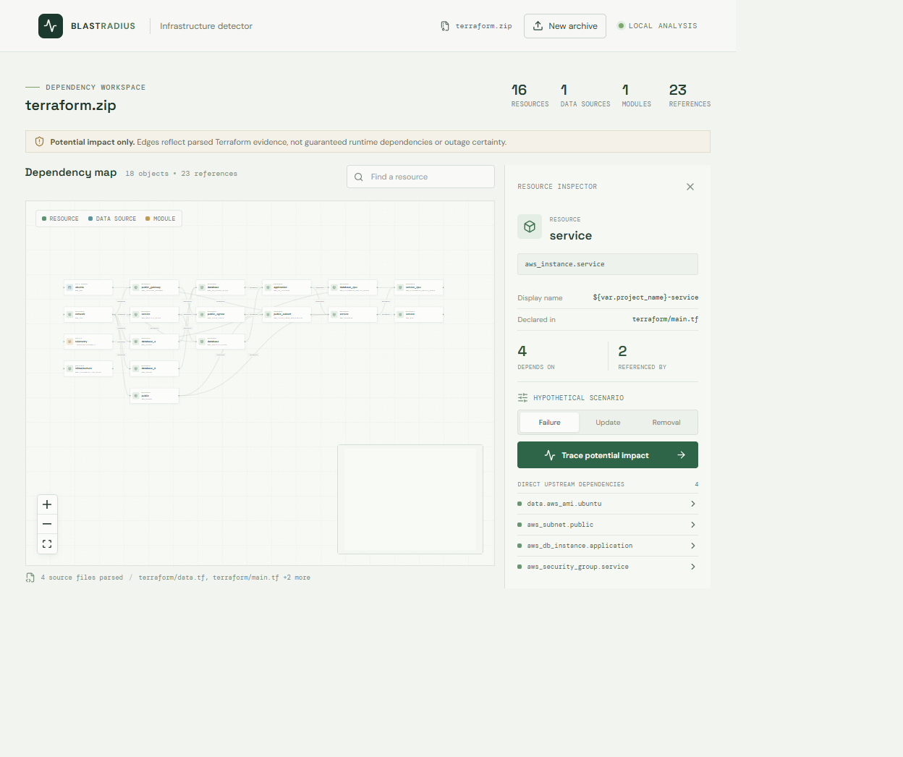
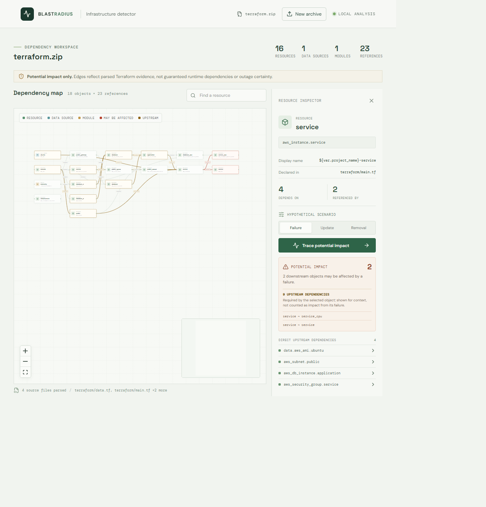

# Infrastructure Blast-Radius Detector

Explore Terraform dependencies and trace which declared resources may be affected by a hypothetical change. Upload a Terraform ZIP, inspect the evidence behind each dependency, and simulate failure, update, or removal scenarios in an interactive graph.

> Terraform references indicate potential impact, not guaranteed runtime dependencies or outage outcomes.

## Screenshots

**Upload Terraform**



**Explore the dependency graph**



**Trace potential impact**



## Features

- ZIP upload with file type, archive size, expanded size, file-count, and path validation.
- Parse `.tf` and `.tf.json` files, plus optional Terraform plan JSON.
- Build nodes for declared resources, data sources, and modules from uploaded configuration; no example infrastructure is injected into an upload.
- Display directed references with source file, attribute, expression, and dependency type as evidence.
- Search, pan, zoom, select nodes and edges, and inspect resource metadata and edge evidence.
- Run breadth-first impact traces for hypothetical failure, update, and removal scenarios. Downstream candidates are marked separately from upstream prerequisites.
- Show planned create, update, delete, and replacement actions when a plan JSON file is included.

## Run Locally

Requirements: Node.js 18 or newer and npm.

Start the backend in one terminal:

```sh
cd backend
npm install
npm start
```

Start the frontend in a second terminal:

```sh
cd frontend
npm install
npm start
```

Open [http://localhost:3000](http://localhost:3000). The frontend expects the API at `http://localhost:5000` by default. Set `REACT_APP_API_URL` before starting the frontend to use another API URL. The backend accepts `PORT` and `FRONTEND_ORIGIN` environment variables; defaults are `5000` and `http://localhost:3000`.

## Upload Terraform

Create a ZIP containing your Terraform files. Preserve relative paths so local modules stay alongside their `.tf` files. The repository includes a sample project under [`terraform/`](terraform/) that can be zipped and uploaded. From PowerShell at the repository root:

```powershell
Compress-Archive -Path terraform -DestinationPath terraform.zip -Force
```

The upload limit is 25 MB. Terraform is parsed for analysis only; the app does not run `terraform init`, `plan`, or `apply`, and it does not need AWS credentials.

To include planned changes, add a JSON plan file such as `plan.json` or `terraform.tfplan.json` to the ZIP. Terraform can render a saved plan with `terraform show -json <plan-file> > plan.json`. Plan JSON may contain sensitive values, so review it before sharing.

## Interpretation

An edge points from a referenced dependency to the resource that consumes it. A trace follows downstream edges to show resources that may be affected; upstream dependencies are shown as context and are not counted as impact. These relationships come from Terraform configuration and do not prove runtime coupling or guarantee an outage.

The included sample describes AWS infrastructure, including EC2 and RDS resources. Reading or uploading it does not create cloud resources. Running `terraform apply` can create billable resources; review the configuration and AWS costs before applying it.

## Tests

Run the parser tests with:

```sh
cd backend
npm test
```

Run the frontend tests with:

```sh
cd frontend
npm test -- --watchAll=false
```
